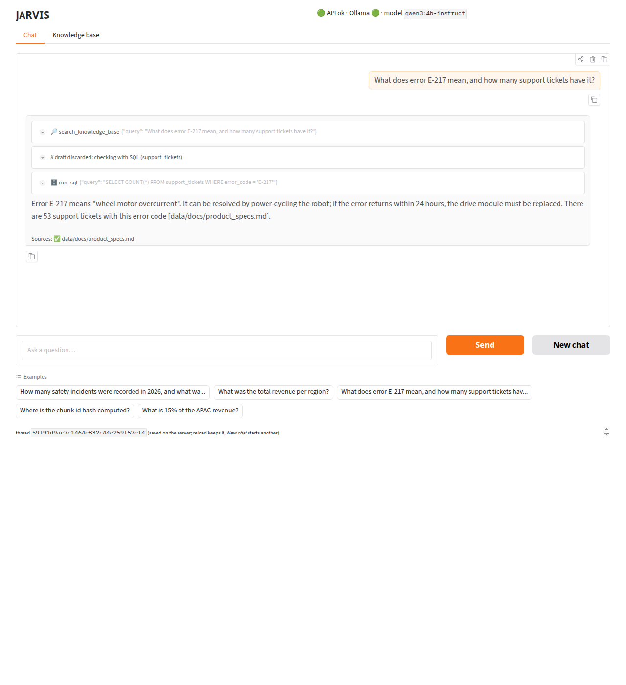

# jarvis-rag

**JARVIS**: a 100% free, locally-runnable LLM agent with RAG over your PDFs, Word docs,
code, websites and CSVs. Built in phases as a learn-by-building project; teaching notes
live in [`docs/`](docs/).

> Status: **Phase 9: Hugging Face Space** (built and tested locally; deploy with `make space-push`)

| Phase | Notes |
|---|---|
| 0: Environment | [docs/phase-0.md](docs/phase-0.md) |
| 1: LLM calls, embeddings, vector DB, RAG and an agent loop with no frameworks | [docs/phase-1.md](docs/phase-1.md) |
| 2: Ingestion (PDF, DOCX, Markdown, code, URLs, CSV→SQLite) into Chroma | [docs/phase-2.md](docs/phase-2.md) |
| 3: Retrieval quality: similarity vs MMR vs hybrid BM25 vs reranker, measured by `eval/` | [docs/phase-3.md](docs/phase-3.md) |
| 4: The agent: `create_agent`, tools (search, SQL, web, calculator), memory, streaming CLI | [docs/phase-4.md](docs/phase-4.md) |
| 5: FastAPI: chat, SSE streaming, ingestion, sources, API key, CORS, Python/JS clients | [docs/phase-5.md](docs/phase-5.md) |
| 6: Gradio UI: streaming chat with tool steps and checked citations, uploads, source management | [docs/phase-6.md](docs/phase-6.md) |
| 7: Providers: Groq / Gemini / OpenRouter free tiers, FastEmbed CPU embeddings, local fallback | [docs/phase-7.md](docs/phase-7.md) |
| 8: Docker: hardened CPU image, Compose with the host's Ollama or fully self-contained | [docs/phase-8.md](docs/phase-8.md) |
| 9: Hugging Face Space: baked read-only demo, build gated on the retrieval eval | [docs/phase-9.md](docs/phase-9.md) |

## Quick start

Prerequisites: [Ollama](https://ollama.com) running locally, [uv](https://docs.astral.sh/uv/), `make`.

```bash
make setup          # .venv (Python 3.12) + pinned deps + .env
make pull-models    # qwen3:4b-instruct, qwen3:1.7b, nomic-embed-text
make check          # environment doctor
make test           # no GPU/Ollama needed
```

**Machines with ≤16 GB RAM:** Ollama's llama-server keeps recent prompts' KV cache in
system RAM (default limit 8 GB) and can get OOM-killed. Cap it once (see
[docs/phase-3.md](docs/phase-3.md#incident-ollama-killed-by-the-oom-killer-halfway-through-the-eval));
`make check` warns if it's uncapped:

```bash
sudo mkdir -p /etc/systemd/system/ollama.service.d
printf '[Service]\nEnvironment="LLAMA_ARG_CACHE_RAM=1024"\n' | sudo tee /etc/systemd/system/ollama.service.d/cache-ram.conf
sudo systemctl daemon-reload && sudo systemctl restart ollama
```

## Ingest your data

Put files in `data/docs` (PDF, DOCX, Markdown, text), code in `data/code`, CSVs in
`data/csv`, then:

```bash
make demo-data      # optional: a small demo corpus to try everything on
make ingest         # idempotent: re-run after any change, only changed chunks are embedded
make sources        # list what's indexed

.venv/bin/python -m jarvis_rag.ingest --url https://example.com/docs --crawl-depth 1
.venv/bin/python -m jarvis_rag.ingest --path ~/projects/my-repo     # respects .gitignore
.venv/bin/python -m jarvis_rag.ingest --delete https://example.com/docs
.venv/bin/python -m jarvis_rag.vectorstore "how do I reset E-217?" -k 3 --type docx
```

Compare retrieval strategies on the 56-question eval set (needs `make demo-data ingest`):

```bash
make eval                                    # hit@1/3/5, MRR, latency per mode and per question kind
.venv/bin/python -m jarvis_rag.retriever "what does E-217 mean?"   # one query, all four modes
```

Chat with JARVIS (it searches, runs read-only SQL, fetches URLs, does arithmetic, and cites):

```bash
make chat                                                       # REPL; /new /thread NAME /history /quit
.venv/bin/python -m jarvis_rag.agent -q "Total revenue per region?"
.venv/bin/python -m jarvis_rag.agent --thread work              # same thread id = same memory
make eval-agent                                                 # tool choice, numbers, citations, abstention
```

No GPU, or want a bigger model? Switch providers in `.env` (everything else stays the same):

```bash
LLM_PROVIDER=groq  GROQ_API_KEY=...        # or gemini / openrouter, all with free tiers
LLM_FALLBACK=ollama                        # rate-limited? that step runs locally instead
EMBED_PROVIDER=fastembed                   # embeddings in-process on CPU, no Ollama needed
make providers                             # which models your keys can use today
```

Hosted providers see your questions and the retrieved document chunks. Keep private data on Ollama.

Or run it in Docker (no GPU toolkit needed: the container uses the Ollama already on your machine):

```bash
make docker-build && make docker-up        # http://127.0.0.1:8000/ui, same storage/ and data/ as on the host
docker compose --profile cpu up -d jarvis-cpu   # self-contained: FastEmbed + hosted LLM (needs API_KEY, UI_PASSWORD)
```

Use it in the browser:

```bash
make app                    # one process: http://127.0.0.1:8000/ui (API on the same port)
make api & make ui          # or two: API on :8000, UI on http://127.0.0.1:7860
```



Serve it over HTTP (interactive docs at http://127.0.0.1:8000/docs):

```bash
make api                                                        # API_HOST:API_PORT from .env
curl -s localhost:8000/chat -H "X-API-Key: $KEY" -H 'content-type: application/json' \
     -d '{"message": "How many support tickets are open?"}'
curl -s localhost:8000/ingest/file -H "X-API-Key: $KEY" -F file=@report.pdf
JARVIS_API_KEY=$KEY python examples/client.py "What does E-217 mean?"     # streaming, httpx only
JARVIS_API_KEY=$KEY node examples/client.js "Which robot lasts longer?"   # streaming, no deps
```

CSVs become SQLite tables in `storage/jarvis.db` (only their schema is embedded).
Conversations live in `storage/memory.db`; uploads in `data/uploads/`.
Vectors live in `storage/chroma`.

## Learn by building

`learn/` rebuilds each core idea with nothing but HTTP calls and numpy:

```bash
.venv/bin/python learn/01_tokens_and_llm_call.py     # tokens, speed, temperature, context window
.venv/bin/python learn/02_embeddings_cosine.py       # embeddings + cosine similarity by hand
.venv/bin/python learn/03_vector_db_from_scratch.py  # vector DB in ~60 lines, brute force vs IVF
.venv/bin/python learn/04_rag_without_framework.py   # chunk -> embed -> retrieve -> cite
.venv/bin/python learn/05_agent_loop_from_scratch.py # the tool-calling loop behind every agent
.venv/bin/python learn/06_chunking_experiments.py    # chunk size/overlap vs hit@k and MRR
.venv/bin/python learn/07_chroma_tour.py             # Chroma: collections, metrics, persistence, filters
```

All configuration lives in `.env` (see [`.env.example`](.env.example)).

## Default models (tuned for a 4 GB GPU)

| Role | Model | Where it runs |
|---|---|---|
| Chat | `qwen3:4b-instruct` (Q4_K_M) | GPU, all layers, 8k context |
| Fallback chat | `qwen3:1.7b` | GPU |
| Embeddings | `nomic-embed-text` (768-dim) | CPU, so it never evicts the chat model |

With 8 GB+ VRAM, try `CHAT_MODEL=qwen3:8b`; with 12 GB+, `qwen3:14b`.
