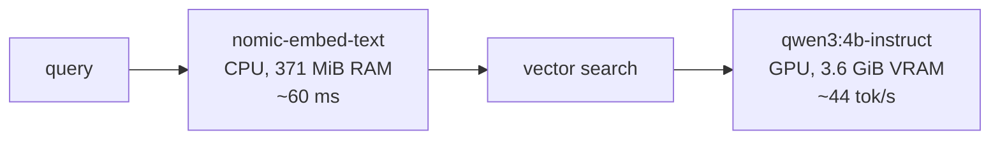

# Phase 0: Environment

**Goal:** a local LLM running on the GPU, a Python 3.12 project that can talk to it,
and a doctor script that proves it, with numbers.

## What we built

| File | Purpose |
|---|---|
| `jarvis_rag/config.py` | Every knob (models, context, GPU layers, chunking, paths) in one pydantic-settings class, read from `.env` |
| `jarvis_rag/llm.py` | `get_chat_model()` / `get_embeddings()`: the only place that knows which provider class to build |
| `jarvis_rag/check_env.py` | `make check`: Python, GPU, Ollama, models, VRAM prediction, live chat + embedding smoke tests, CPU/GPU placement |
| `tests/` | 18 tests, no GPU or Ollama needed |
| `requirements.in` → `requirements.txt` | direct deps → fully pinned lockfile (`uv pip compile`) |
| `Makefile` | `setup`, `lock`, `pull-models`, `check`, `test` |

## The machine

```
GPU   NVIDIA GTX 1650, 4 GiB (3.6 GiB usable after driver/CUDA context)
RAM   5.1 GiB + 4 GiB swap
OS    Ubuntu 26.04, Ollama 0.40.6 (systemd service, localhost:11434)
```

The master plan assumed 6 GB+ VRAM and `qwen3:8b`. The 8B model is ~5 GB of weights,
which doesn't fit in VRAM, and 5 GB of system RAM can't absorb the spill. So we
measured and chose a smaller model instead of guessing.

---

## Concept 1: What is a "model file"?

An LLM is a big list of numbers (weights) plus the recipe for using them
(architecture: how many layers, heads, the tokenizer). Ollama stores both in
one **GGUF** file:

```
GGUF file
├── metadata   architecture=qwen3, block_count=36, head_count_kv=8, context_length=262144,
│              tokenizer vocab + merges, chat template
└── tensors    4,022,468,096 weights, quantized to Q4_K_M
```

`ollama show qwen3:4b-instruct` shows the metadata; `curl localhost:11434/api/show`
returns all of it as JSON. `check_env.model_arch()` reads exactly these fields.

## Concept 2: Quantization (what Q4_K_M means)

Training stores each weight as 16-bit float. Quantization rounds weights to fewer bits:

| Format | Bits/weight | 4B model size | Quality |
|---|---|---|---|
| F16 | 16 | ~8.0 GB | reference |
| Q8_0 | ~8.5 | ~4.3 GB | ≈ lossless |
| **Q4_K_M** | **~4.85** | **~2.4 GB** | small loss: the usual sweet spot |
| Q4_0 | ~4.5 | ~2.3 GB | noticeably worse |

- **Q4**: ~4 bits per weight.
- **K**: "k-quant": weights are grouped in blocks (super-blocks of 256), each block
  stores its own scale/min, so precision adapts to the local value range.
- **M**: "medium" mix: the most sensitive tensors (parts of attention/FFN output)
  are kept at higher precision (Q6_K), the rest at Q4_K.

That's why the effective rate is ~4.85, not 4.0 bits.

## Concept 3: VRAM math

```
VRAM ≈ weights + KV cache + compute buffers

weights  = params × bits_per_weight / 8
         = 4.02e9 × 4.85 / 8          ≈ 2,326 MiB

KV cache = 2 (K and V) × layers × kv_heads × head_dim × bytes_per_value × context_tokens
         = 2 × 36 × 8 × 128 × 2 B × 8192 ≈ 1,152 MiB   (147 KB per token!)

compute  ≈ a few hundred MiB of scratch space for the matmuls
```

Verified against reality:

| | Predicted | Measured |
|---|---|---|
| KV cache @ 4096 ctx | 576 MiB | llama.cpp log: `llama_kv_cache: size = 576.00 MiB` (exact) |
| Total @ 8192 ctx | 3,478 MiB + buffers | `ollama ps`: 3,613 MiB |

Notes:
- **KV cache grows linearly with context.** Doubling `NUM_CTX` doubles it. That's why
  "supports 256k context" on the model card means nothing on a 4 GB card.
- **GQA saves memory.** Qwen3-4B has 32 query heads but only 8 KV heads
  (grouped-query attention), which makes the KV cache 4× smaller than it would otherwise be.
- `OLLAMA_KV_CACHE_TYPE=q8_0` would halve the KV cache (needs flash attention, which is
  already on). It's an upgrade lever if we need 16k context later.

## Concept 4: Tokens and the context window

- A **token** is a sub-word chunk. Rough rule for English: 1 token ≈ 4 characters ≈ ¾ word.
- The **context window** (`NUM_CTX=8192`) is everything the model sees at once:
  system prompt + chat history + retrieved chunks + tool results + the answer it's writing.
  For RAG that budget fills fast: 5 chunks × 800 chars ≈ 1,000 tokens.
- **Prompt eval** (reading input, parallel) is fast; **eval** (generating, one token at
  a time) is slow. Our numbers: ~95 tok/s prompt, ~44 tok/s generation.

---

## What we found along the way (the real lessons)

### 1. "Fits in VRAM" isn't enough: placement matters
Ollama/llama.cpp auto-fit keeps **1 GiB free as a safety margin**. On a 3.6 GiB card,
that pushed 5 of 37 layers to the CPU:

| Setting | Placement | Generation speed |
|---|---|---|
| auto, ctx 4096 | 23% CPU / 77% GPU | 26.3 tok/s |
| `num_gpu=99`, ctx 4096 | 100% GPU | 42.9 tok/s |
| `num_gpu=99`, ctx 8192 | 100% GPU | 42.9 tok/s |

A layer on the CPU makes **every token** wait for the slow part.
`NUM_GPU=99` forces all layers onto the GPU. If you ever hit out-of-memory, set
`NUM_GPU=auto` or lower `NUM_CTX`.

### 2. Two models fighting over the GPU
RAG needs the chat model **and** the embedding model. Loading `nomic-embed-text` on the
GPU **evicted** the chat model, so every query would reload it (3–18 s).
The fix was `EMBED_NUM_GPU=0`: the 137M-param embedder runs on the CPU in ~60 ms, and the
chat model stays resident on the GPU.



### 3. Thinking vs instruct models
Ollama's `qwen3:4b` tag is now **Qwen3-4B-Thinking-2507**, which always reasons.
With `think=false` it doesn't stop thinking: it writes the reasoning **into the answer**
(662 tokens to answer "17×23?"). For an agent that's slow and breaks tool-call parsing.
`qwen3:4b-instruct` (Instruct-2507) answers directly in 4 tokens.

### 4. Small models can't do arithmetic
`qwen3:4b-instruct` answered **401** for 17×23 (correct: 391). That's why the agent gets a
`calculator` tool in Phase 4 and SQL for aggregates. Never trust a 4B model's mental math.

---

## Try it

```bash
make check                                    # full doctor
ollama ps                                     # what's loaded, where
NUM_GPU=auto make check                       # watch placement + tok/s drop
NUM_CTX=16384 make check                      # does it still fit? (watch "loaded" line)
ollama run qwen3:4b-instruct --verbose        # interactive, prints timing stats
watch -n1 nvidia-smi                          # in another terminal while chatting
```

## Quiz

1. Llama-3.1-8B has 32 layers, 8 KV heads and head_dim 128. How much KV cache (f16)
   does a 16k-token context need? Would it fit next to Q4_K_M weights on this GPU?
2. Why does the doctor run the embedding model on the CPU but the chat model on the GPU,
   when the GPU is faster for both?
3. A model card says "Q4_K_M, 4B params, 256k context". Which of those three numbers
   is the least useful for predicting whether it runs on your machine, and why?

<details><summary>Answers</summary>

1. 2 × 32 × 8 × 128 × 2 B × 16,384 = **2 GiB** of KV cache. The weights are 8.0e9 × 4.85 / 8
   ≈ 4.5 GiB. Total ≈ 6.5 GiB+, so no, not even close on 3.6 GiB.
2. Only one of them fits on the GPU alongside the other. The embedder is tiny (137M params)
   and only runs once per query on a short string, so the CPU handles it in ~60 ms.
   The chat model generates hundreds of tokens per answer, and each one would be about
   10× slower on the CPU. Put the expensive, repeated work where the speed is.
3. The 256k context: it's the *trained maximum*. The context you can actually afford is set
   by your VRAM via the KV-cache formula (here ~8k). Params × quant tells you the weight size.
</details>
