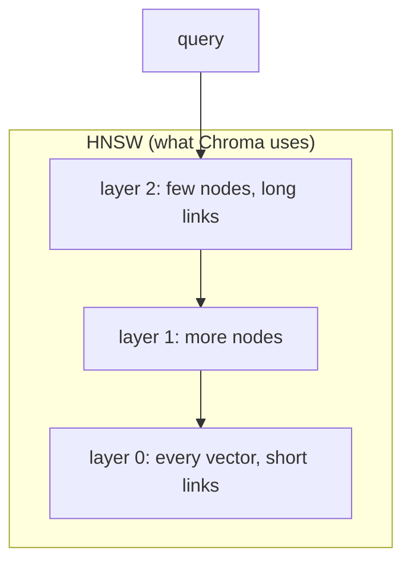
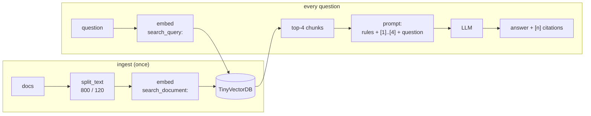
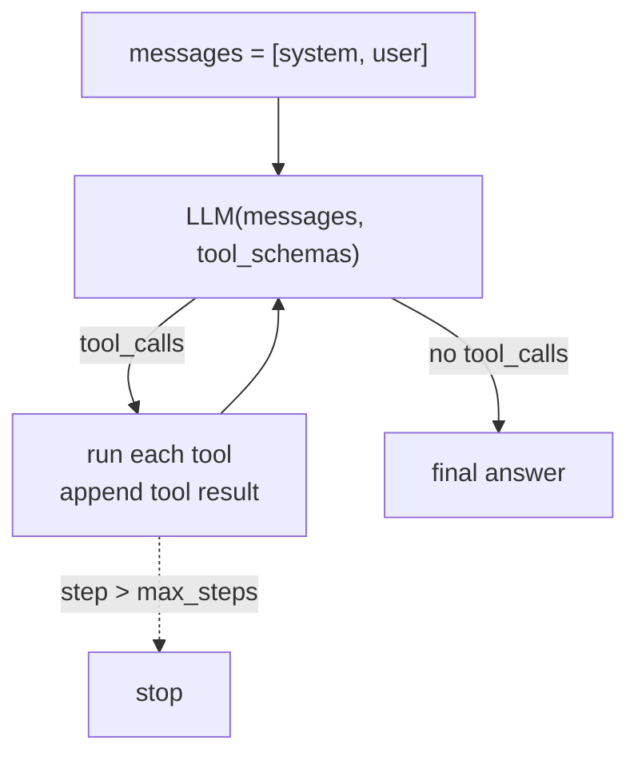

# Phase 1: From scratch, no frameworks

**Goal:** build every core piece of an LLM agent with RAG by hand (HTTP calls, numpy,
~600 lines in total) so that when LangChain does it for us from Phase 2 on, nothing is magic.

```bash
.venv/bin/python learn/01_tokens_and_llm_call.py      # ~20s
.venv/bin/python learn/02_embeddings_cosine.py        # ~5s
.venv/bin/python learn/03_vector_db_from_scratch.py   # ~30s
.venv/bin/python learn/04_rag_without_framework.py    # ~30s
.venv/bin/python learn/05_agent_loop_from_scratch.py  # ~60s
.venv/bin/python learn/06_chunking_experiments.py     # ~15s
```

| File | What it builds |
|---|---|
| `learn/ollama_api.py` | The whole "framework": `generate`, `chat`, `embed` (three HTTP POSTs) |
| `learn/sample_docs/` | Halcyon Robotics, a **fictional** company (5 docs). The model can't know these facts, so correct answers prove retrieval worked |
| `tests/test_learn.py` | 32 offline tests: splitter, vector DB, IVF, calculator safety, agent loop with a scripted fake model |

---

## 01: Tokens and the raw LLM call

```
POST /api/generate {"model", "prompt", "options": {temperature, num_ctx, ...}}
  → {"response", prompt_eval_count/duration, eval_count/duration, load_duration}
```

**Measured:** reading the prompt runs at ~92 tok/s (all tokens processed in parallel);
generating runs at ~44 tok/s (one forward pass per token). Streaming showed the first
token after 0.14 s, and that number is what makes a UI feel fast.

**Tokens are not characters:**

| Text | chars | tokens |
|---|---|---|
| `hello world` | 11 | 2 |
| `Supercalifragilisticexpialidocious` | 34 | 11 |
| `{"user_id": 4821, "active": true}` | 33 | 15 |
| `2026-10-19T21:38:43+05:30` | 25 | **25**: Qwen gives every digit its own token |
| `नमस्ते दुनिया` (Hindi) | 13 | 13 |
| `こんにちは世界` (Japanese) | 7 | **2**: Qwen is from a Chinese lab, so CJK is cheap |

**Temperature:** at 0 the model gave `BuddyBox` 4 out of 4 times. At 1.5 it gave
`Benny, BuddyBox, Benny, BuddyBot`. A fixed `seed` makes sampling repeatable.

**The context-window trap.** We put a secret at the start of a ~3,000-token prompt:

| num_ctx | tokens the model actually saw | answer |
|---|---|---|
| 8192 | 3,032 | `TANGERINE-42` ✓ |
| 1024 | 514 | "I don't know what the secret code is…" |

Ollama **silently truncates** an oversized prompt. There's no error, just a wrong
answer. A RAG system must budget its context: system prompt + retrieved chunks + chat
history + room for the answer.

## 02: Embeddings and cosine similarity

```
cos(a, b) = (a · b) / (|a| × |b|)
```

`nomic-embed-text` returns 768 floats with length 1.0. Because the vectors are
normalised, **cosine similarity = dot product**, which is why vector DBs store
unit vectors.

| | car | automobile | vehicle | truck | banana |
|---|---|---|---|---|---|
| car | 1.000 | **0.914** | 0.870 | 0.634 | 0.469 |

What we learned:
- **Scores are relative.** Unrelated words still score ~0.45, not 0, so retrieval *ranks*
  results instead of applying a fixed cutoff.
- **Meaning beats keywords.** For "How do I reset my password?", "I forgot my login
  credentials" (no shared words) scored 0.71, above a dictionary definition of
  "password" (0.57).
- **Embeddings encode topic, not truth.** "Safe near people" vs "**not** safe near people"
  scored **0.95**. Retrieval finds the passage; the LLM has to read it carefully.
- **Model conventions matter.** nomic expects the `search_query: ` / `search_document: `
  prefixes it was trained with. Using them raised the relevant-vs-irrelevant gap
  from 0.249 to 0.262.

## 03: A vector database from scratch

`TinyVectorDB` (~60 lines): unit-normalised matrix, `add` (upsert by id), `delete`,
`query` (one matmul + `argpartition` for the top k), metadata `where` pre-filter, `save`/`load`.

Two failures worth remembering:
- "How heavy a load can **the big robot** lift?" ranked the 12 kg Wren **0.003 above**
  the 45 kg Kestrel. The embedding doesn't know Kestrel is the heavy-duty model.
- With `where={"topic": "product"}`, a leave question still returned two product facts.
  **Top-k always returns k results**, however irrelevant.

**Brute force grows linearly:** 1k → 0.25 ms, 10k → 3.4 ms, 100k → 27 ms per query.

**ANN (approximate nearest neighbours)**. We built an IVF index: k-means into 256 buckets,
then search only the `nprobe` nearest buckets.

| method (N=100k) | ms/query | recall@10 | data scanned |
|---|---|---|---|
| brute force | 26.6 | 1.000 | 100% |
| IVF nprobe=1 | 0.21 | 0.810 | 0.4% |
| IVF nprobe=4 | 0.81 | 0.915 | 1.6% |
| IVF nprobe=16 | 5.8 | 0.980 | 6.2% |

**recall@k** is the fraction of the *true* top-k the index returned. Every ANN index trades
recall for latency through a knob like this.



HNSW starts at the sparse top layer, hops greedily toward the query, then descends.
That costs about O(log N) hops. Its knobs are `M` (links per node: memory vs recall)
and `ef_search` (candidates kept: latency vs recall).

## 04: RAG by hand



**The splitter** is recursive: it tries `\n\n`, then `\n`, then `. `, then a space, and only
hard-cuts text that has none of those. It then packs the pieces back up to `chunk_size`,
carrying up to `overlap` characters into the next chunk. That's what LangChain's
`RecursiveCharacterTextSplitter` does. (The tests caught a bug in my first version: it
appended a separator to the last piece too.)

**Results:**

| Question | Outcome |
|---|---|
| Annual leave days | ✓ "25 days [4]", but the right chunk ranked **4th**. The intro chunk matched "Halcyon Robotics" from the question. With k=1 we'd have got it wrong |
| E-217 keeps coming back | ~ "replace the drive module [1]". It skipped the "power-cycle first" step |
| Approve own PR | ✓ quotes the policy, cites [1] |
| Longer battery life, by how much | ✓ Wren 9h vs Kestrel 6.5h = 2.5h, cites [2][3] |
| CEO's name (not in the docs) | ✓ "I don't know based on the provided documents." |

`cited_sources()` maps `[n]` markers back to chunk ids and **drops invented numbers**.
Never trust a citation you didn't check.

## 05: The agent loop



That loop is all an agent is. `create_agent` adds middleware, streaming, memory and
structured state around it.

What the code shows:
- **Tool schemas are prompts.** The `description` is how the model chooses a tool.
- **Tool errors become tool results** (`"Error: ZeroDivisionError..."`) so the model can recover.
- **The step limit** guards against infinite tool loops.
- **The calculator parses an AST and never uses `eval()`.** The tests check that it rejects
  `__import__('os')…`, attribute access and `9 ** 999999`.
- **Under the hood, a tool call is just text.** With `raw=True` the model literally writes
  `<tool_call>{"name": "calculator", "arguments": {...}}</tool_call>`, and Ollama parses it.

**The biggest lesson of the phase: the system prompt decides whether tools get used.**

| System prompt | "Which Halcyon robot carries more…?" |
|---|---|
| "For questions about Halcyon, call search_handbook" | no tool, "I don't have information about…" |
| "You know NOTHING about Halcyon except what search_handbook returns. Before answering ANY question that mentions Halcyon… call search_handbook first" | searches, "Kestrel K2 … 45 − 12 = 33 kg [source]" |

With the weak prompt, behaviour **changed between runs, even at temperature 0**. The
choice between calling a tool and answering directly was close enough that tiny numerical
differences (Ollama reusing a cached prompt prefix from earlier questions) flipped it.
The strong prompt made 12 out of 12 decisions correctly.

Still imperfect: the model did `25 − 11` and `45 − 12` **in its head** despite
"Never do math in your head". The answers were right, but this won't scale. Phase 4
mitigations: fewer tools, sharper descriptions, low temperature, and checking the
model's work in code.

## 06: Chunking experiments

14 questions with known answer phrases, 8 configs:

| size | overlap | chunks | hit@1 | hit@5 | MRR | chars read @3 |
|---|---|---|---|---|---|---|
| 200 | 0 | 63 | 1.00 | 1.00 | 1.000 | 489 |
| 400 | 0 | 33 | 0.93 | 1.00 | 0.964 | 850 |
| 800 | 120 | 16 | 0.93 | 1.00 | 0.964 | 1,874 |
| 1600 | 0 | 9 | 0.57 | 0.93 | 0.714 | 2,560 |

What the data says (not what I expected):
- **Huge chunks retrieve worst.** A 1,600-char chunk averages several topics into one vector
  ("embedding dilution").
- **Overlap made no difference here.** The structure-aware splitter never cut a fact in half
  on these well-formatted docs. Overlap matters for long unbroken prose and hard cuts.
- **Retrieval score ≠ answer quality.** At 200 *and* at 800 chars, the chunk containing
  "Battery life: 9 hours" doesn't name the **Wren W1**, because the heading fell into the
  previous chunk. Chunk size can't fix that. **Contextual chunk headers** can (prepend the
  doc title + section heading to each chunk), and Phase 2 does this.
- **14 questions = 0.07 per question.** The differences between 200, 400 and 800 are noise.
  That's why Phase 3 builds a proper eval set.

---

## Lessons that carry into the real build

| Phase 1 finding | What we'll do |
|---|---|
| Silent truncation past `num_ctx` | Token budgeting for retrieved context + history (Phase 4) |
| nomic needs task prefixes | Wrap embeddings so queries and docs get the right prefix (Phase 2) |
| Headings lost from chunks | Contextual chunk headers in ingestion (Phase 2) |
| Right chunk ranked 4th; "big robot" miss | Hybrid BM25 + vector, reranking, measured with hit@k/MRR (Phase 3) |
| Prompt wording flips tool use | Tight system prompt + tool descriptions, tested (Phase 4) |
| Model does mental math anyway | Calculator/SQL tools + prompt + eval checks (Phase 4) |

## Try it

- In `01`, set `num_ctx` to 2048 and find the prompt length where the secret disappears.
- In `02`, add your own word pairs. Can you find two synonyms scoring below 0.7?
- In `03`, change `nlist` to 64 or 1024. What happens to recall at `nprobe=1`, and to build time?
- In `04`, set `k=1` and re-ask the annual leave question.
- In `05`, delete the `description` from the calculator schema and see if tool use changes.
- In `06`, add 10 questions of your own, especially ones that need two facts.

## Quiz

1. `prompt_eval` runs at ~92 tok/s but `eval` at ~44 tok/s on the same GPU. Why is reading
   faster than writing?
2. A user asks "Is the Wren W1 safe near people?", and the top chunk says "The robot is
   **not** safe near people" with score 0.95. What went right and what could still go wrong?
3. Your agent sometimes answers from memory instead of calling `search_knowledge_base`,
   even at temperature 0. Name three changes you could make, cheapest first.

<details><summary>Answers</summary>

1. All prompt tokens are already known, so the GPU processes them in one parallel batch
   (a big matrix multiply). Output tokens depend on each other, so each one needs its own
   full forward pass, which is limited by memory bandwidth rather than compute.
2. Retrieval did its job: it found the passage on the right topic. But embeddings barely
   distinguish negation (we measured 0.95 between "safe" and "not safe"), so the score says
   nothing about the answer. The LLM must read the chunk, and the chunk must say *which*
   robot it means (contextual headers).
3. (a) Rewrite the system prompt to say the model knows nothing about the domain except
   what the tool returns, and to always search first. (b) Sharpen the tool description and
   reduce the number of tools. (c) Remove the choice entirely: always retrieve before the
   LLM call (a RAG chain instead of an agent), or force a tool call on the first step.
</details>
