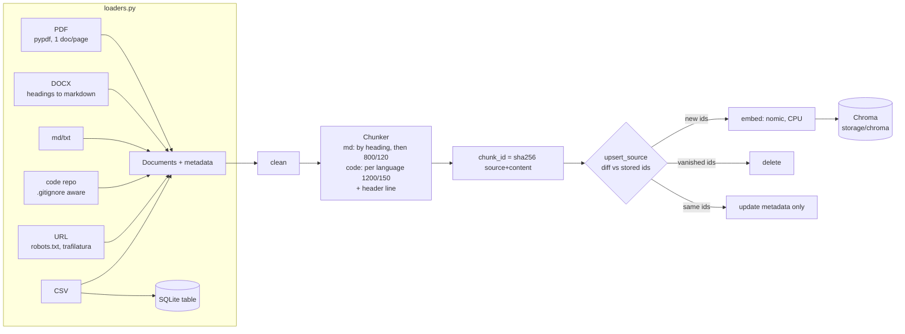

# Phase 2: Ingestion + Chroma

**Goal:** turn PDFs, Word files, Markdown, code repos, web pages and CSVs into a
persistent, searchable knowledge base. Re-running ingestion must be cheap and
must never create duplicates.

```bash
make demo-data      # Halcyon demo corpus: md, pdf, docx, csv + a code snapshot
make ingest         # data/docs + data/code + data/csv  (idempotent)
make sources        # what's in the index
.venv/bin/python -m jarvis_rag.ingest --url https://en.wikipedia.org/wiki/Retrieval-augmented_generation
.venv/bin/python -m jarvis_rag.vectorstore "how do I fix E-217?" -k 3 --type docx
.venv/bin/python learn/07_chroma_tour.py   # collections, metrics, persistence, filters
```

## What we built

| File | Job |
|---|---|
| `jarvis_rag/loaders.py` | One loader per input type, returning whole `Document`s with metadata |
| `jarvis_rag/ingest.py` | `Chunker` (per-type splitting + contextual headers), `collect`, `ingest_documents`, `prune`, CLI |
| `jarvis_rag/vectorstore.py` | `KnowledgeBase`: Chroma collection (cosine), incremental `upsert_source`, `delete_source`, `sources`, `search` + search CLI |
| `jarvis_rag/llm.py` | `PrefixedEmbeddings`: adds nomic's `search_query:` / `search_document:` prefixes automatically |
| `jarvis_rag/demo_data.py` | Writes a demo PDF, DOCX and CSVs with no extra libraries, so the tests can use real files offline |
| `learn/07_chroma_tour.py` | Teaching script for the Chroma concepts below |



### Every input type

| Type | Loader | Chunked as | Metadata (beyond source/type/title/path/chunk_id/ingested_at) |
|---|---|---|---|
| `pdf` | `pypdf.PdfReader`, one Document per page | plain 800/120 | `page` |
| `docx` | our own `docx_to_markdown` (zip + XML) | markdown | `section` |
| `text` | md / txt / rst | markdown | `section` |
| `code` | `.gitignore`-aware walk; skips binaries, lockfiles, minified files, `node_modules`, `.venv` | `RecursiveCharacterTextSplitter.from_language`, 1200/150 | `language`, `symbols`, `line` |
| `web` | httpx + trafilatura (markdown out), robots.txt respected, same-site BFS with `--crawl-depth` and `URL_MAX_PAGES` | markdown | `url` |
| `table` | pandas `to_sql` into `storage/jarvis.db`; **only schema + value ranges + 3 sample rows are embedded** | one chunk | `table` |

Why are CSVs not embedded row by row? "Total revenue per region" is a `GROUP BY`,
not a similarity search. Embedding 10,000 rows would give the agent 5 random rows
to add up wrongly. The embedded schema doc exists only so the agent can *discover*
the table. In Phase 4 it will query the data with `run_sql`. Retrieval for
"total revenue per region last quarter" puts that schema doc first (0.680).

### Two places where I didn't follow the spec, and why

1. **`langchain-community` is being sunset.** Importing it prints `DeprecationWarning:
   langchain-community is being sunset and is no longer actively maintained`. Its
   `PyPDFLoader` is a thin wrapper around `pypdf`, so we call `pypdf` directly
   (12 lines), and the package is not in our dependencies.
2. **`Docx2txtLoader` throws away headings.** `docx2txt` returns flat text. Word
   *heading styles* are exactly what our chunk headers are built from, so
   `docx_to_markdown` reads `word/document.xml` itself, turns `Heading N` into `#`s
   and keeps tables as `| a | b |` rows. Measured effect for *"how should I clean
   the lidar window?"*: before, the manual wasn't in the top 3; after, it was #1
   (0.761), as `[Kestrel K2 Maintenance Manual > Weekly checks]`.

## Concept 1: contextual chunk headers (fixing learn/06's finding)

In Phase 1, the chunk containing "Battery life: 9 hours" never said *which robot*
it was about. Now every chunk's first line says where it came from:

```
[Halcyon Robotics — Product Specifications > Wren W1 (light-duty)]
The Wren W1 carries single totes and parcels and is designed for narrow aisles.
- Payload: 12 kg
- Battery life: 9 hours of continuous operation
```
```
[data/code/jarvis_rag/llm.py (python): PrefixedEmbeddings, PrefixedEmbeddings.__init__, ...]
[Halcyon Robotics 2026 Safety Report, page 2]
[table support_tickets]
```

The header is **embedded** (it helps retrieval: the vector now "knows" it's about the
Wren W1) and **shown to the LLM** (so the answer can name the robot and cite the page).
Markdown is first split **by heading** (`MarkdownHeaderTextSplitter`), so a chunk
never spans two sections, and each section is then split to 800 chars. The header
adds ~40–100 chars on top of `CHUNK_SIZE`.

A heading with no text under it produces no chunk of its own. Its name lives on in
the breadcrumb of its children (`Wren W1 > Battery`).

## Concept 2: idempotent, incremental ingestion

```
chunk_id = sha256(source + "\n" + chunk_text)

 stored ids for source        new ids from this run
 ┌───────────────┐           ┌───────────────┐
 │  a  b  c  d   │           │  a  b  c  e   │
 └───────────────┘           └───────────────┘
   d: stale  -> delete        e: fresh -> embed + add       a b c: kept -> metadata refresh only
```

Measured on the demo corpus (16 sources, 98 chunks):

| Run | Embedded | Time |
|---|---|---|
| First ingest (docs + csv) | 41 / 41 | 5.8 s |
| Again, nothing changed | **0** / 105 | **0.2 s** |
| One line edited in `product_specs.md` | **1** (1 removed, 5 kept) | 0.7 s |
| `demo_data.py` deleted from `data/code` | 0, `pruned data/code/jarvis_rag/demo_data.py` | |

Design decisions worth noticing:

- **The id includes the source**, so the same paragraph in two files is two chunks. Each
  file can then be deleted independently. Identical chunks *within* one file collapse to one.
- **Code line numbers live in metadata, not in the chunk text.** If `line 120` were
  in the text, adding one import at the top would change every chunk's id and
  re-embed the whole file. Since unchanged chunks still get their metadata
  refreshed (`collection.update`, no embedding), the line numbers stay correct.
- **Pruning:** ingesting a folder makes the index mirror it. Sources under that
  folder that no longer exist on disk are deleted (`--no-prune` turns this off).
  URLs are never pruned this way; use `--delete <url>`.
- **One broken file never aborts the run.** It is listed under `skipped` with the reason.

## Concept 3: Chroma (from `learn/07_chroma_tour.py`)

**Collections** are namespaces: one vector space each. Ours is `COLLECTION_NAME=jarvis`.
Changing `EMBED_MODEL` (or its prefixes) means a different vector space, so re-ingest
into a fresh collection. Mixing vectors from two models gives silently meaningless
scores, not an error.

**Distance metrics.** Chroma's default is squared L2; we set `{"hnsw": {"space": "cosine"}}`.
Same query and 4 sentences under each metric:

```
cosine: Wren W1 battery 0.370, Kestrel K2 0.516, Annual leave 0.524, Passwords 0.618
    l2: Wren W1 battery 0.740, Kestrel K2 1.031, Annual leave 1.048, Passwords 1.236
    ip: Wren W1 battery 0.370, Kestrel K2 0.516, Annual leave 0.524, Passwords 0.618
```

nomic's vectors are unit length (norms printed as `1.`), and for unit vectors
`L2² = 2 − 2·cos` (0.740 = 2 × 0.370) and `ip = 1 − dot = 1 − cos`. So all three give
the same ranking. They diverge only for un-normalised vectors, where L2 also punishes
vector *length*. Cosine keeps rankings stable when Phase 7 swaps models.
`KnowledgeBase.search` converts Chroma's *distance* into a *similarity*
(`1 − distance`), so higher means better, as in learn/02.

**Persistence** is two kinds of files:

```
storage/chroma/chroma.sqlite3              2.2 MB  documents, metadata, FTS5 full-text index,
                                                   and embeddings_queue (write-ahead log, 473 ops)
storage/chroma/<segment-uuid>/*.bin        HNSW index (data_level0.bin = vectors + graph level 0)
```

Every write is appended to the SQLite log first, so it is durable immediately. The HNSW
files are the search index built from that log, flushed every `sync_threshold` (1000)
writes. A fresh `KnowledgeBase()` reopened the 126-chunk store in ~80 ms. HNSW
knobs from learn/03 are visible in the config: `max_neighbors=16` (M), `ef_search=100`.

**Metadata filtering** narrows the search *before* ranking. For "how do I fix error E-217?":

```
no filter                         0.698 [Kestrel K2 Maintenance Manual > Error E-217 after maintenance]
                                  0.650 [Product Specifications > Common error codes]
                                  0.602 [table support_tickets]
{"type": "docx"}                  manual chunks only
{"type": {"$in": ["pdf","docx"]}} manual + safety report pages
{"$and": [{"type":"code"},{"language":"python"}]}   code only
where_document {"$contains": "E-217"}   exact text match, no vectors (uses the FTS index)
```

Operators: `$eq $ne $gt $gte $lt $lte $in $nin`, combined with `$and` / `$or`.
Phase 4's `search_knowledge_base(source_type=...)` is a `{"type": ...}` filter.

## What went wrong along the way (and the fixes)

| Symptom | Cause | Fix |
|---|---|---|
| `llm.py` chunk listed `__init__, embed_query` but not `PrefixedEmbeddings` | Symbol regex `^\s*def` also matched the *blank lines above*, so the match began before the chunk | `[ \t]*` instead of `\s*`. Methods are now qualified (`PrefixedEmbeddings.embed_query`). There is a regression test. |
| "Clean the lidar window?" ranked `demo_data.py` **first** | The code snapshot contained the manual's text as Python strings | Excluded that file. A real lesson: code and fixtures duplicate docs, so use a `type` filter |
| Maintenance manual missing from top 3 | docx2txt dropped Word headings | Our own DOCX parser keeps headings (see above) |
| Wikipedia chunks full of `<sup>\[5\]</sup>` and `\[edit\]` | trafilatura keeps footnote markup | `clean_web` strips them. Leaving them would collide with our own `[n]` citations in Phase 4 |
| robots.txt test URL | `/w/index.php?...` is `Disallow`ed by Wikipedia | Skipped with the reason, as intended |

## Retrieval is not solved yet

For *"Which robot has the longer battery life?"*, the top hit was the **Warranty**
section (0.684), ahead of Kestrel K2 (0.673) and Wren W1 (0.667). With k=3 both
robots are still present, but the gap between right and wrong is 0.01–0.02 in
score. Comparison questions, exact codes ("E-217") and names are where pure vector
search is weakest. Phase 3 measures this properly and adds BM25 hybrid search, MMR
and a reranker.

## Tests (30 new, 80 total, still no Ollama)

- `tests/test_loaders.py`:
  - PDF pages and titles.
  - DOCX headings come through as markdown.
  - Refusals: binary, too big, empty, lockfile, non-UTF-8.
  - Nested `.gitignore` plus skip dirs.
  - Python and JS symbols.
  - CSV → SQLite: normalised column names, re-load replaces rather than appends.
  - Web crawl against a fake site (`httpx.MockTransport`): depth, robots.txt, other domains and the page limit.
  - `clean_web`.
- `tests/test_ingest.py`:
  - Section breadcrumbs.
  - Chunk size limits and id uniqueness.
  - Code symbols map back to the correct `line`.
  - PDF page headers.
  - **Idempotency and incremental edits** (1 added, 1 removed, 2 kept).
  - Duplicate collapse.
  - Delete and filters.
  - Cosine config.
  - Persistence across instances.
  - An end-to-end run on the demo corpus that checks prune.

These use `DeterministicFakeEmbedding(size=32)` and a temp-dir Chroma.

## Try it

1. Point it at a real repo: `python -m jarvis_rag.ingest --path ~/some/project`, then
   `python -m jarvis_rag.vectorstore "where is auth handled?" --type code`. Check the
   `symbols` in the headers.
2. Crawl a docs site: `--url https://docs.trychroma.com/docs/overview/introduction --crawl-depth 1`.
   Watch `URL_MAX_PAGES` cap it, then search with `--type web`.
3. Edit a paragraph in one of your files and re-run `make ingest`. Predict the
   added/removed/unchanged numbers before you look.
4. Set `EMBED_DOCUMENT_PREFIX=""` in `.env`, ingest into `COLLECTION_NAME=noprefix`,
   and compare top-1 scores for the same queries. What does the prefix buy?
5. Open `storage/chroma/chroma.sqlite3` with `sqlite3` and read `embedding_metadata`
   for one chunk id.

## Quiz

1. A 50-page PDF has one sentence fixed on page 30 and is re-ingested. Roughly how
   many chunks are embedded, and why not all of them? What would change if the
   chunk id were `sha256(content)` without the source?
2. Why does a CSV become a SQLite table plus *one* embedded schema chunk, instead of
   one embedded chunk per row? Name a question type each approach answers well.
3. All three Chroma metrics gave the same ranking on nomic vectors. Under what
   condition would L2 and cosine rank differently, and which would you trust for text?

<details><summary>Answers</summary>

1. With 800-char chunks over ~1 page each, only the chunk(s) containing the edited
   sentence change text, so typically **1 is embedded** (2 if the sentence sits in an
   overlap region). Every other chunk has the same `sha256(source+content)` and is
   kept. Without the source in the hash, two files containing the same paragraph
   would share one id, and deleting either file would delete the other's chunk too.
2. Vector search finds *similar text*, so it can't sum, count or group. "Total revenue
   per region" needs every row and arithmetic, which is what SQL does. The embedded
   schema chunk answers "is there any data about sales?" (discovery), and SQL answers
   "how much?" (aggregation). Row embeddings would also cost 1 vector per row for
   chunks that each say almost nothing.
3. When vectors are not unit length. L2 then also measures *magnitude* (often tied to
   text length or token frequency, not meaning), while cosine compares only
   *direction*. For text, trust cosine, or normalise the vectors first, after which
   all three agree.

</details>
