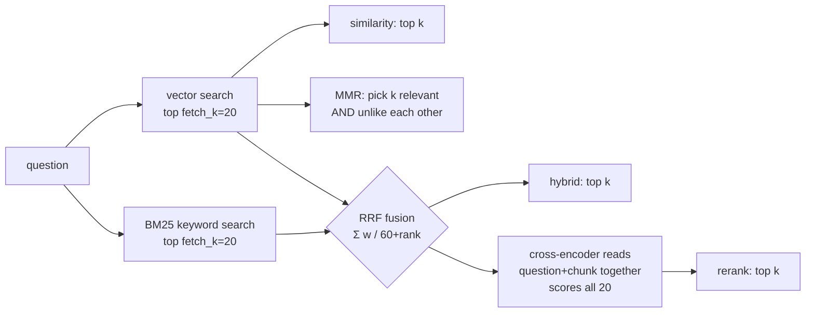

# Phase 3: Retrieval quality

**Goal:** stop guessing which retrieval strategy is better. Build an eval set, measure
four strategies on it, look at *which* questions each one gets wrong, and pick the
default from the numbers.

```bash
make demo-data ingest                    # the corpus the eval set is written against
make eval                                # all four modes: hit@k, MRR, latency, per-kind table
.venv/bin/python eval/run_eval.py --misses                  # which questions each mode got wrong
.venv/bin/python eval/run_eval.py --set bm25_weight=0.3     # try a setting without editing .env
.venv/bin/python -m jarvis_rag.retriever "Which robot has the longer battery life?"
make eval-answers                        # + generate answers, grade with LLM-as-judge (slow)
```

## What we built

| File | Job |
|---|---|
| `jarvis_rag/retriever.py` | `Retriever` with four modes; our own `BM25`, `rrf_fuse`, filter matcher; `CrossEncoderReranker` (FastEmbed ONNX) |
| `eval/qa_set.jsonl` | 56 questions: `id, kind, question, expected_source, must_contain, expected_answer` |
| `eval/run_eval.py` | Gold-label check, hit@1/3/5, MRR, complete@5, latency, per-kind table, misses, `--set` overrides, LLM-as-judge answer grading |

New settings: `RETRIEVAL_MODE` (default **rerank**), `RETRIEVAL_K=5`, `FETCH_K=20`,
`MMR_LAMBDA=0.5`, `BM25_WEIGHT=0.5`, `RERANKER_MODEL=Xenova/ms-marco-MiniLM-L-6-v2`.

### Why no `EnsembleRetriever` / `BM25Retriever`

Checked before coding (ground rule 1): LangChain v1 has no `langchain.retrievers`
module any more (`langchain` now contains only `agents, chat_models, embeddings, mcp,
messages, rate_limiters, tools`). `EnsembleRetriever` lives on only in the legacy
`langchain-classic` package, and `BM25Retriever` in `langchain-community`, which is being
retired. Both algorithms are short, so `retriever.py` implements them directly.
`rrf_fuse` is the same weighted reciprocal rank fusion that `EnsembleRetriever` uses.

## The four strategies



**BM25** scores documents by keyword overlap:

```
score(q,d) = Σ_t  idf(t) · tf·(k1+1) / (tf + k1·(1 − b + b·|d|/avgdl))
idf(t)     = ln(1 + (N − df + 0.5)/(df + 0.5))
```

- Rare words count most (idf).
- Repeating a word has diminishing returns (k1 = 1.5).
- Long chunks are normalised (b = 0.75).

Our tokenizer stems words (`batteries` = `battery`) and keeps codes **both whole and
split**: `E-217` becomes `e-217`, `e` and `217`. That is exactly what embeddings are
bad at. To an embedding, "E-217" and "E-330" are near neighbours; to BM25 they are
different words.

**Reciprocal rank fusion** combines the vector and BM25 rankings using *ranks*, never
scores. Cosine (0–1) and BM25 (unbounded) can't be added, but positions can:
`score = 0.5/(60+rank_vec) + 0.5/(60+rank_bm25)`. A chunk ranked 2nd by both beats a
chunk ranked 1st by one and missing from the other.

**MMR** (maximal marginal relevance) picks chunks one at a time, maximising
`λ·sim(query, chunk) − (1−λ)·max sim(chunk, already picked)`. It is meant to stop
five near-duplicate chunks from filling the context.

**Cross-encoder reranking.** Our embedder is a *bi-encoder*: it squeezes the question
and each chunk into one vector each, *independently*, and compares the vectors. A
cross-encoder reads `[question] [SEP] [chunk]` *together*, with attention across both,
and outputs one relevance score. It is far more accurate, but it must run once per
(question, chunk) pair at query time, so it can't search a whole corpus. Hence
"retrieve 20 cheaply, rerank 20 precisely".

## Results (56 questions, 53 with a known source, k = 5)

```
mode         hit@1  hit@3  hit@5    MRR  complete@5  p50 ms
similarity    0.85   0.96   0.96  0.903        1.00      30
mmr           0.85   0.91   0.91  0.877        0.50      42
hybrid        0.91   0.96   0.96  0.934        1.00      31
rerank        0.92   1.00   1.00  0.956        1.00     394
```

```
MRR by question kind
kind           n similarity        mmr     hybrid     rerank
code           5      0.900      0.900      0.900      0.733
comparison     2      0.750      0.750      1.000      1.000
docx           3      1.000      1.000      1.000      1.000
exact          8      0.875      0.875      0.938      1.000
fact          14      1.000      1.000      1.000      1.000
paraphrase    15      0.822      0.733      0.833      0.933
pdf            3      1.000      1.000      1.000      1.000
table          3      0.833      0.833      1.000      1.000
```

How to read it:

- **Facts phrased like the document are solved by everything (1.000).** The differences
  are all in paraphrases, exact codes, comparisons and code. An eval set made only of
  easy questions would have told us all four strategies are equal.
- **Hybrid fixes exact tokens.** *"What is part HK-2231?"*: similarity didn't find the
  manual in the top 5 at all; its #1 was `vectorstore.py`, a file full of hex hashes,
  which "looks like" a part number to an embedding. BM25 matches the literal token
  `hk-2231`, so hybrid ranks it 2nd and rerank 1st. The exact-question MRR goes
  0.875 → 0.938 → 1.000.
- **Rerank fixes paraphrases** (0.833 → 0.933). *"Until what time can I stay in the
  building in the evening?"* shares no keywords with "open from 07:00 to 21:00".
  Similarity put it 3rd, hybrid lost it, and the cross-encoder ranked it 1st.
- **Rerank is *worse* on code** (0.900 → 0.733). `ms-marco-MiniLM` was trained on web
  search passages, not Python. For *"Where are CSV files turned into SQLite tables?"* it
  preferred the chunk with `load_file, table_name` over `load_csv`. That's a known
  limitation: when code questions matter, pass a `type: code` filter, use a code-aware
  reranker, or skip reranking for code (Phase 4's tool can do this).
- **MMR made things worse here, and the reason teaches something.** Its
  `complete@5` is 0.50: for *"Which robot has the longer battery life?"*, MMR kept
  Warranty, Wren W1, a maintenance chunk, the release train and a sales table, and
  *dropped the Kestrel K2 chunk because it looked too similar to the Wren W1 chunk it
  already had*. Diversity is the
  wrong goal when the answer needs two parallel facts. With more diversity (λ=0.3),
  completeness falls to **0.00**. MMR is for open "tell me about X" questions over
  repetitive corpora (many near-identical pages), not for this corpus.

### Tuning sweep (one setting at a time, `--set`)

| Setting | Values → MRR | Verdict |
|---|---|---|
| `bm25_weight` (hybrid) | 0.3 → 0.925, **0.5 → 0.934**, 0.7 → 0.903 | Equal weighting is best; leaning on either side loses |
| `fetch_k` (rerank) | 10 → 0.947 (204 ms), **20 → 0.956** (472 ms), 40 → 0.956 (878 ms) | 20 is enough: doubling it only doubles latency |
| `mmr_lambda` | 0.3 → 0.868 (complete 0.00), 0.5 → 0.877, 0.7 → 0.896 | The less diversity, the better, on this corpus |

### A performance bug worth remembering: padding

The first rerank run measured **2,521 ms per query** for an 80 MB model. Profiling 20
real candidates on the Ryzen 5600H:

```
batch_size=64  2,342 ms     every pair padded to the longest candidate (1,101 chars ≈ 300+ tokens)
batch_size=4     965 ms
batch_size=1     281 ms     no padding at all
```

Transformers process a batch as one rectangular tensor, so 19 short chunks paid for
the one long code chunk, and attention cost grows with the *square* of length.
`batch_size=1` (or batching by similar length) gave an **8× speedup** with identical
scores. GPUs need big batches; on a CPU with variable-length inputs, padding usually
costs more than batching saves.

## Choosing the default: `RETRIEVAL_MODE=rerank`

- **Quality:** best on every metric except code; it is the only mode with hit@5 = 1.00.
- **Cost:** ~0.4 s on CPU, against an LLM answer that takes several seconds, plus
  80 MB downloaded once into `storage/models`. It never touches the GPU, so the chat
  model keeps its VRAM.
- **Failure mode:** if the model can't be loaded (offline first run, Hugging Face down),
  `Retriever` logs one warning and falls back to `hybrid`.
- **Honesty about sample size:** hybrid → rerank is +1 question at hit@1 and +2 at
  hit@5 out of 53. That's a real but small difference; the per-kind table is more
  convincing than the headline. On your own documents, write 30–50 questions and
  re-run `make eval` before trusting any of these defaults.

## Answer quality: LLM-as-judge

Retrieval metrics say whether the right chunk was *found*. They don't say whether the
answer was *right*. `--answers` goes end to end:

1. Retrieve 5 chunks.
2. Ask `qwen3:4b-instruct` to answer from them, with numbered citations (the same
   rules as learn/04).
3. Have the **same model** grade each answer against the reference using
   `with_structured_output(Judgement)`, which returns `correct`, `faithful` and `reason`.

Table questions are skipped, since they need SQL (Phase 4). The 3 unanswerable
questions are scored by an exact abstention check, not by the judge.

### What the judge said, and what was actually true

I read all 106 answers (53 per mode) and graded them by hand:

| | similarity | rerank |
|---|---|---|
| Judge: correct | 40 / 50 | 42 / 50 |
| **Human: correct** | **46 / 50** | **47 / 50** |
| Abstained on unanswerable ("I don't know") | 3 / 3 | 3 / 3 |
| Wrongly said "I don't know" on an answerable question | 3 | 1 |
| Invented citation numbers | 0 | 0 |
| Judge false negatives (right answer marked wrong) | 7 | 5 |
| Judge false positives (wrong answer marked right) | 1 | 0 |
| Judge agreement with human | 84% | 90% |
| Median answer time | 4.2 s | 4.2 s |

**Lesson 1: a 4B model is a bad judge, and it is biased in one direction.** Every
judge error but one was *too strict*:

- "Employees get 25 days of paid annual leave" was marked wrong because the reference
  also mentions public holidays.
- "1.2 m/s maximum near people" was marked wrong even though it matches the reference.
- On code questions it claimed `estimate_vram_mib` wasn't in an answer that names it.

The `faithful` field was useless: the model set it to the same value as `correct`
almost every time, even for "I don't know", which the prompt defines as faithful. The
judge's absolute numbers understate quality by 5–7 points. Use a judge like this only
for *relative* comparisons on the same questions. Even then, spot-check it. A stronger
judge (a bigger local model, or a free cloud model in Phase 7) is the standard fix.

**Lesson 2: retrieval quality shows up as abstentions, not hallucinations.**
Similarity's misses (the shelves question, part HK-2231, the parking question) came
back as **"I don't know"**, not as made-up answers. That is the grounding prompt doing
its job: a retrieval miss turns into a safe failure. Rerank had 1 such abstention;
similarity had 3.

**Lesson 3: better retrieval did not mean better answers on every question.** The
end-to-end difference is 1 question out of 50 (46 vs 47), smaller than the retrieval
difference. The 4B model recovers from imperfect rankings when the right chunk is
anywhere in the top 5. It also makes generation errors that retrieval can't fix:

- **q32 (rerank):** "The **Kestrel K2** has a longer battery life… therefore the **Wren
  W1** has a longer battery life by 2.5 hours." The model contradicts itself. Both
  chunks were retrieved and the arithmetic is right, but the first sentence is wrong.
  The similarity run answered this question correctly, with the chunks in a different
  order. Small models are sensitive to context order.
- **q42 (rerank):** "What is part HK-2231?" The chunk saying "Replace the wheel motor
  brushes (part HK-2231)" was ranked **1st**, yet the model said "I don't know". It
  didn't connect "what is X" to "do Y (part X)".
- **q46 (both):** it named the inner helper `ignored` instead of `iter_files`. Arguably
  a fair reading of the code.

These are exactly the failures Phase 4 addresses: tool use (`calculator` for the
arithmetic, filtered search for code), a stronger system prompt, and a fallback
model for retries.

## Incident: Ollama killed by the OOM killer halfway through the eval

The first answer run died after 30 questions with `httpx.RemoteProtocolError: Server
disconnected`. The kernel log:

```
kernel: Out of memory: Killed process 10631 (llama-server) anon-rss:3209204kB
systemd: ollama.service: Failed with result 'oom-kill'.
```

`llama-server` was using **3.2 GB of system RAM**, although every layer of the model
was on the GPU. Ollama's own log explained it:

```
srv  prompt_save:  - saving prompt with length 1011, total state size = 142.184 MiB
srv  update:       - cache state: 55 prompts, 5048.614 MiB (limits: 8192.000 MiB ...)
```

Recent llama.cpp servers keep the **KV-cache state of recent prompts in host RAM**, so
a follow-up request with the same prefix skips prefill (the `cached n_tokens = 513`
lines). At 8k context each saved prompt is about 140 MiB. The default limit is
**8,192 MiB**, more than this machine's total 5.2 GB, and an eval sends 100+ different
prompts. Ollama 0.40.6 has no setting for it, but `llama-server` reads
`LLAMA_ARG_CACHE_RAM`, and Ollama passes its environment through:

```bash
# /etc/systemd/system/ollama.service.d/cache-ram.conf
[Service]
Environment="LLAMA_ARG_CACHE_RAM=1024"
```

After `systemctl daemon-reload && systemctl restart ollama`, the log shows
`limits: 1024.000 MiB` and, under load, `removing oldest entry`. The cache now evicts
old prompts instead of growing, and the full run of 106 answers completed. The 1 GB
still holds about 7–10 recent prompts, which is what a chat session reuses: each turn
extends the previous prompt.

`make check` now includes this check (`check_prompt_cache_ram`). It warns when the
effective limit is more than a quarter of system RAM:

```
✓ prompt cache RAM       limit 1024 MiB, system RAM 5256 MiB
```

This would have hit Phase 4 and Phase 5 too: a long chat or a busy API grows the
same cache. Note the pattern for debugging: client error → server log → kernel log →
the exact allocation message.

## Evaluating the evaluation

- **Relevance = right source AND a `must_contain` phrase**, not just the right file.
  product_specs.md answers both robots' questions; only the chunk with the right
  numbers counts.
- **`unreachable()` checks the gold labels before scoring.** If a phrase isn't intact in
  any chunk of its source (a typo, a stale corpus, or the chunker cutting it in half),
  the run prints a warning instead of blaming the retriever. All 53 labels are reachable.
- **complete@5** exists because hit@k counts a comparison as solved when only one of
  the two facts is retrieved. That's how MMR's failure would have been hidden.
- **The eval set is small and written by the same person who built the system.**
  It's good for comparing strategies on *this* corpus, not for absolute claims.

## Tests (26 new, 106 total, no Ollama, no model download)

- `tests/test_retriever.py`:
  - Tokenizer: codes kept whole and split, stemming, stopwords.
  - BM25: idf formula, rare terms win, tf saturation.
  - Every filter operator.
  - RRF maths: agreement wins, and weights work.
  - Each mode on a temp Chroma with fake embeddings. With random vectors, *BM25 alone*
    must carry "E-217" through hybrid.
  - Rerank with a fake cross-encoder.
  - **Fallback to hybrid when the reranker can't load.**
  - The BM25 index rebuilds after new ingests.
- `tests/test_check_env.py`: parsing `LLAMA_ARG_CACHE_RAM` from systemd output.
- `tests/test_eval.py`:
  - The relevance rule (case- and whitespace-insensitive).
  - rank and complete@k.
  - Metric arithmetic.
  - QA-set schema.
  - Unreachable-label detection.

## Try it

1. `python -m jarvis_rag.retriever "E-330"` and then `"the battery is overheating"`.
   Which modes win on each, and why?
2. Add 5 questions about the Wikipedia RAG page (`--url` from Phase 2) to
   `qa_set.jsonl` with `"kind": "web"`, and re-run `make eval`.
3. Swap the reranker: `--set reranker_model=jinaai/jina-reranker-v1-tiny-en` (130 MB,
   8k context). Does code MRR recover? What happens to latency?
4. Break it on purpose: set `CHUNK_SIZE=2000`, re-ingest into
   `COLLECTION_NAME=big`, and run `make eval`. Which kinds suffer most?
5. Write a question you expect *every* mode to fail, then see if you're right with `--misses`.

## Quiz

1. Hybrid search found "HK-2231" when vector search didn't. Explain in terms of how
   each one represents the query. Why does RRF fuse ranks instead of adding scores?
2. A cross-encoder is more accurate than our embedding model. Why don't we use it to
   search the whole knowledge base directly?
3. MMR scored *worse* than plain similarity here. Describe a corpus and question where
   MMR would clearly *help*.

<details><summary>Answers</summary>

1. The embedding turns "What is part HK-2231?" into one 768-dim *meaning* vector.
   An unseen alphanumeric code has little meaning, so its vector lands near other
   code-ish, hash-ish text (`vectorstore.py`). BM25 compares exact tokens: `hk-2231`
   appears in exactly one chunk, so its idf is high and that chunk wins. Ranks are
   fused because the scores live on different scales (cosine 0–1 vs BM25 0–∞, varying
   per query). Adding them would let whichever scale is bigger dominate; ranks are
   comparable by construction.
2. It has no index. It must run the full transformer on every (query, chunk) pair at
   query time: 100k chunks would mean 100k forward passes per question. Bi-encoders
   embed chunks *once* at ingest, so a query costs one embedding plus an ANN lookup. The
   standard design is a cheap high-recall first stage (vector + BM25, 20–100 candidates),
   then the expensive precise reranker on those.
3. A corpus with many near-duplicates: 30 versions of the same release notes, or a
   crawled site where every page repeats a long boilerplate section. The question is
   open-ended ("what changed across the 2026 releases?"). Plain similarity returns five
   copies of the same paragraph; MMR returns five *different* relevant paragraphs.

</details>
