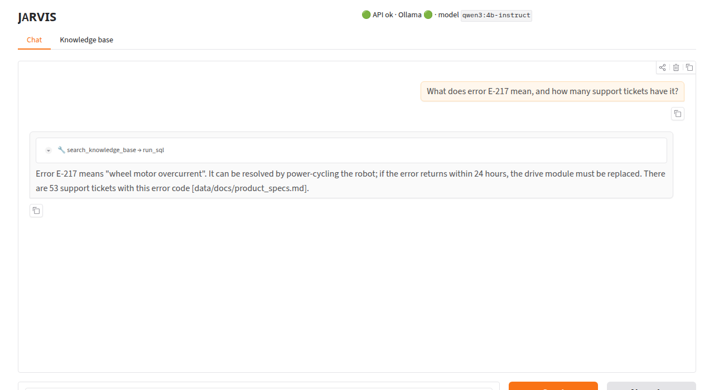
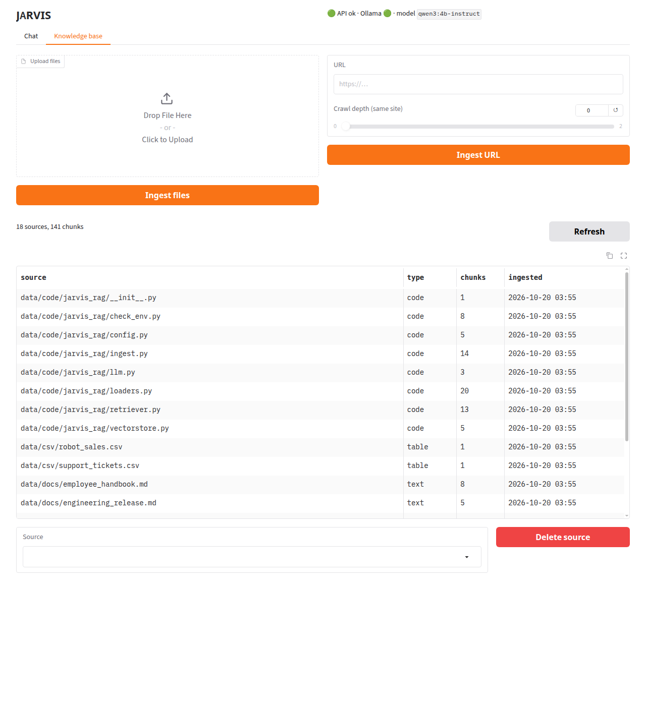

# Phase 6: Web UI (Gradio)

**Goal:** a browser front end that shows what the agent does as it does it: tool
calls, discarded drafts, checked citations. It also manages the knowledge base:
upload, URL ingest, list, delete. It is built on the Phase 5 API, not beside it.

```bash
make app                  # one process: API + UI at http://127.0.0.1:8000/ui
make api & make ui        # two processes: UI at http://127.0.0.1:7860 calls the API at API_URL
```


## What we built

| File | Job |
|---|---|
| `jarvis_rag/ui.py` | `build_ui(client)`: Chat and Knowledge base tabs. Handlers are plain functions of a client (`chat_turn`, `upload_files`, `ingest_url`, `delete_source`, `restore_thread`). `ui_auth` policy. `--with-api` single-process mode. |
| `jarvis_rag/client.py` | `JarvisClient`: typed httpx client for the API (SSE parsing, `ApiError`, URL-safe deletes) |
| `jarvis_rag/api.py` | + `GET /threads/{thread_id}`: a conversation's messages, so the UI can redraw it after a reload |
| `jarvis_rag/agent.py` | + `discard` stream event from the SQL guard (via LangGraph's custom stream) |
| `tests/test_ui.py` | 11 tests: handlers with a fake client, endpoint exposure, auth policy, `JarvisClient` against the real API |

New settings: `UI_HOST=127.0.0.1`, `UI_PORT=7860`, `API_URL`, `UI_USERNAME`, `UI_PASSWORD`.
New dependency: `gradio 6.29.1`, the newest release at least two weeks old (6.30.0
was 12 days old). Its new transitive dependencies were all checked for age too (the
newest, `markupsafe 3.0.4`, was 18 days old). It is compatible with the FastAPI 0.142 and
Starlette 1.7 pins.

## Architecture: the UI is just another API client

```
                  ┌──────────── make ui (:7860) ────────────┐        ┌──── make api (:8000) ────┐
browser ◀──WS/SSE──▶│ Gradio: chat_turn(), upload_files(), …  │──HTTP──▶│ /chat/stream  /ingest/…  │──▶ agent, Chroma,
                  │ JarvisClient(API_URL, API_KEY)          │  + key  │ /sources  /threads/{id}  │    SQLite, Ollama
                  └─────────────────────────────────────────┘        └──────────────────────────┘

make app: the same two apps in one process. gr.mount_gradio_app(create_app(), ui, path="/ui"),
and the UI's client calls http://127.0.0.1:API_PORT, which is itself.
```

Why not call the agent directly from Gradio? Doing it this way means:
- **One backend.** The CLI, the API and the UI share `stream_events`, the same agent and
  memory, the same locks. A bug fixed in the API is fixed in the UI.
- **The key stays on the server.** The Gradio process holds `API_KEY`; the browser
  talks only to Gradio. That's the "put a small backend in front" advice from
  `examples/client.js`.
- **The UI can't do anything a script can't.** Every feature goes through a documented
  endpoint, which keeps the API honest. One endpoint was missing: after a page reload
  there was no way to redraw the conversation, hence `GET /threads/{id}`.
- **Testability.** Handlers take a client, so `tests/test_ui.py` drives them with a fake
  client that replays SSE events, and checks `JarvisClient` against the real API
  through `TestClient`. No browser needed.

The cost is one extra local HTTP hop (under a millisecond, next to seconds of
generation), plus a second process unless you use `make app`.

## What the chat shows

- **Tool calls as steps.** Gradio renders an assistant message with
  `metadata={"title": …, "status": "pending"|"done", "log": …}` as a collapsible box. A
  step opens as "🔎 search_knowledge_base" (pending) and is filled with the result
  preview when the `tool_result` event arrives. Errors get "(error)" in the title.
- **Tokens as they arrive.** Each `token` event appends to the current bubble. After a
  tool call, new text starts a new bubble.
- **Checked citations.** The `answer` event's citations become a footer: `✅ label`
  when a tool returned it, and `⚠️ ~~label~~ (no tool returned this)` when it didn't.
  The screenshot above shows the limit from Phase 5's quiz: "53 support tickets
  [data/docs/product_specs.md]" gets a ✅. The search *did* return `product_specs.md`,
  but the 53 came from SQL. Checking where a source came from is not checking that it
  supports the claim.
- **Memory across reloads.** `thread_id` lives in `gr.BrowserState` (the browser's
  localStorage). On page load the UI calls `/threads/{id}` and redraws the conversation,
  with tool steps summarised as one "🔧 search_knowledge_base → run_sql" box. *New chat*
  forgets the id; the old thread stays on the server.



### A streaming bug the UI exposed: the draft that was overruled

The first end-to-end run showed **two answers** to one question. The model's first
reply ("E-217 means wheel motor overcurrent…", with no ticket count) streamed to the
screen token by token. Then Phase 4's `sql_follow_through` guard rejected it, re-asked,
and the corrected answer streamed below it.

The CLI had the same bug, just less visible. The cause: `stream_mode="messages"`
forwards tokens *while the model generates*, before any middleware has seen the
result. A guard that runs after the model can't un-send them.

The fix: the guard announces its decision on LangGraph's **custom stream**:

```python
get_stream_writer()({"type": "discard", "reason": f"checking with SQL ({table})"})
```

`stream_events` subscribes to `"custom"` alongside `"messages"` and `"updates"`, and
passes the event through (and on through the API's SSE). Clients drop the text streamed
since the last tool call. The UI doesn't delete it silently; it folds the draft into a
collapsed "✗ draft discarded: checking with SQL (support_tickets)" step, so the user
understands why the text they watched appear has changed. Under plain `invoke()` the
writer does nothing, so `ask()` and the tests are unaffected.

The general lesson: **anything that validates output after generation conflicts
with token streaming.** You either buffer (no streaming), retract (this), or validate
before generating (prompting, which is weaker). This is why chat products sometimes
"rewrite" an answer in front of you.

## The knowledge base tab



- Upload several files at once. Each goes through `POST /ingest/file`, and the result
  lists chunks added/removed plus anything skipped. The file picker filters on the
  API's own `UPLOAD_EXTS`, so the two can't disagree.
- URL + crawl depth (slider capped at `MAX_CRAWL_DEPTH`) → `POST /ingest/url`. The SSRF
  guard runs in the API, so the UI gets it for free.
- The table and dropdown refresh after every change (`.then(refresh_kb)`). Deleting
  reports whether the uploaded file was removed and the SQL table dropped.
- Gradio's `max_file_size` is set to `MAX_FILE_MB`, so oversized uploads are refused by
  Gradio *before* they reach disk. That closes, for the UI path, the gap Phase 5 noted
  in Starlette.

## Security: Gradio's defaults vs ours

| Gradio feature | Our setting | Why |
|---|---|---|
| Every event handler is an HTTP endpoint ("Use via API") | Named public endpoints only: `chat`, `upload`, `ingest_url`, `delete`, `sources`; the rest `api_visibility="private"` | A UI button *is* an API. `delete` is callable with `gradio_client` by anyone who can reach the UI (tested: `test_build_ui_exposes_only_named_endpoints`) |
| `share=True` tunnels | `share=False`, explicitly | A public `*.gradio.live` URL to a server that holds your API key is the last thing you want by accident |
| Usage analytics | `GRADIO_ANALYTICS_ENABLED=False`, set before import, plus `analytics_enabled=False` | Project rule: nothing leaves the machine |
| MCP server mode | `mcp_server=False` | Would expose the same handlers as tools to any MCP client |
| No auth | `UI_PASSWORD` is **required** off localhost (`ui_auth`), mirroring the API's rule | The UI holds the API key, so an open UI on the LAN is an open API |
| Error details in the browser | `show_error=False`; handlers turn `ApiError` and connection errors into one-line messages in the chat | No stack traces |

Gradio's own login is a simple username/password form backed by a session cookie. That
is fine for one person on a LAN. For anything public, put real authentication (OAuth,
or HF Spaces' login in Phase 9) in front of it.

## Verifying it without clicking around

- **`gradio_client`** (installed with Gradio) calls the UI's named endpoints the way the
  browser does. One end-to-end run: chat streamed 142 updates (tool steps, a discarded
  draft, a SQL step, the answer); a follow-up on the same thread ("how many of those are
  still open?" → 8, checked against SQLite); upload → listed → deleted with the file.
  `make app` passed the same test at `/ui`, with the API key still enforced on the API
  routes.
- **Screenshots** came from headless Chrome driven over the DevTools protocol (about 40
  lines with the `websockets` package already in the venv): type a question, click
  Send, wait, capture. The same browser profile, reloaded, produced the reload
  screenshot.

## Tests (12 new, 197 total)

- `tests/test_ui.py` (11):
  - `chat_turn` turns a scripted SSE stream into tool steps, a folded discarded draft,
    an error-titled SQL step, and an answer with ✅/⚠️ citations, redrawing once per event.
  - Thread continuation and blank input.
  - API-down and 401 failures shown in the chat.
  - Error events and `restore_thread`.
  - Knowledge base handler messages.
  - The `ui_auth` policy.
  - Only the 5 named endpoints are public.
  - `JarvisClient` against the real API: SSE, `/threads`, deleting a source whose name
    contains `?` and `#`, `ApiError` on 401.
- `tests/test_agent.py` (+1): the guard sends `discard` before the SQL tool call.

## Try it

```bash
make app        # then open http://127.0.0.1:8000/ui
```
- Ask "What was the total revenue per region?" and open the 🗄️ run_sql step to see the
  exact query.
- Ask "How many open tickets are there for E-217?" and watch for a discarded draft.
- Upload a PDF of your own on the Knowledge base tab, then ask about it in Chat.
- Reload the page: the conversation comes back. Click *New chat*: it's gone from the
  screen but still on the server (`curl …/threads/<old id>`).
- `UI_HOST=0.0.0.0 make ui` should refuse to start. Set `UI_PASSWORD` and it shows a
  login form.

## Quiz

1. The SQL guard fixed the answer in Phase 4, so why did Phase 6 still show a wrong
   draft? What are the three ways to reconcile output validation with token streaming?
2. Why does the UI keep only the `thread_id` in the browser (`BrowserState`) and fetch
   the messages from the API, rather than storing the whole chat in localStorage?
3. Gradio exposes each event handler as an endpoint. Why does that make "it's only a
   UI, it doesn't need auth" wrong here, even if the delete button were hidden with CSS?

<details><summary>Answers</summary>

1. Streaming sends tokens while the model is still generating, before any
   after-the-model middleware has seen the full reply. By the time the guard rejected
   it, the draft was already on screen. The options: **buffer** (validate first, then
   send: correct but no streaming), **retract** (stream, then send a `discard`
   event that clients honour: what we did), or **prevent** (better prompting or
   constraints before generation: cheap but never guaranteed). Hybrid setups stream
   freely and buffer only the parts most likely to be rejected.
2. The server is the source of truth. Memory lives in the checkpointer, which the agent
   needs anyway. A second copy in the browser could drift: a different tab, a cleared
   cache, or a thread continued from the CLI with the same id. It would also put the
   conversation, which may contain sensitive document excerpts, in every browser's
   storage. An opaque 128-bit id is small, holds nothing sensitive by itself, and the API
   still requires the key to read the thread.
3. A UI is a set of HTTP endpoints. Hiding a button changes what is *drawn*, not what
   is *callable*: `gradio_client.Client(url).predict("data/docs/x.md", api_name="/delete")`
   works without the page. And the Gradio process holds the API key, so whoever can call
   its endpoints has the key's power. Hence: real auth when off localhost, only
   deliberate endpoints public, and the dangerous operations behind the same API checks
   as everything else.

</details>
